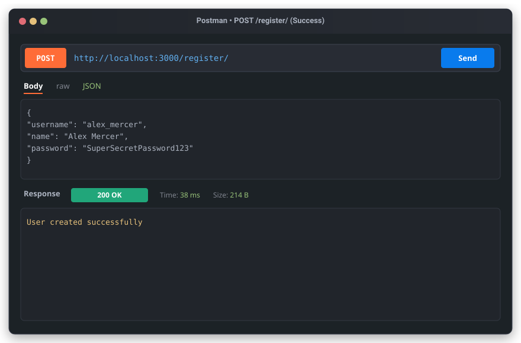
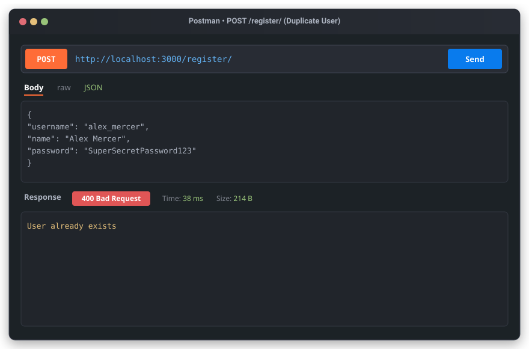
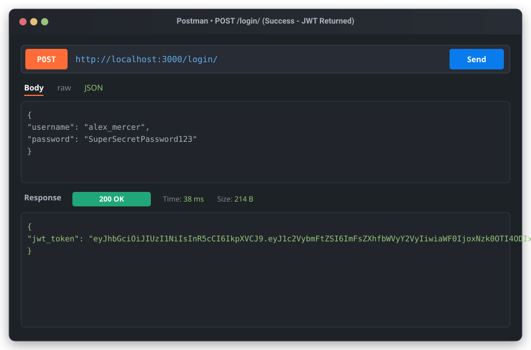
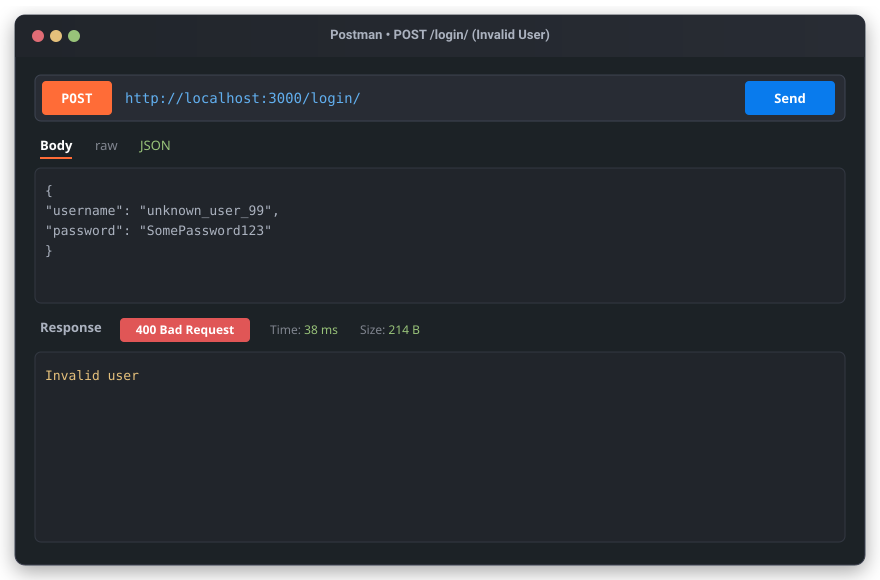
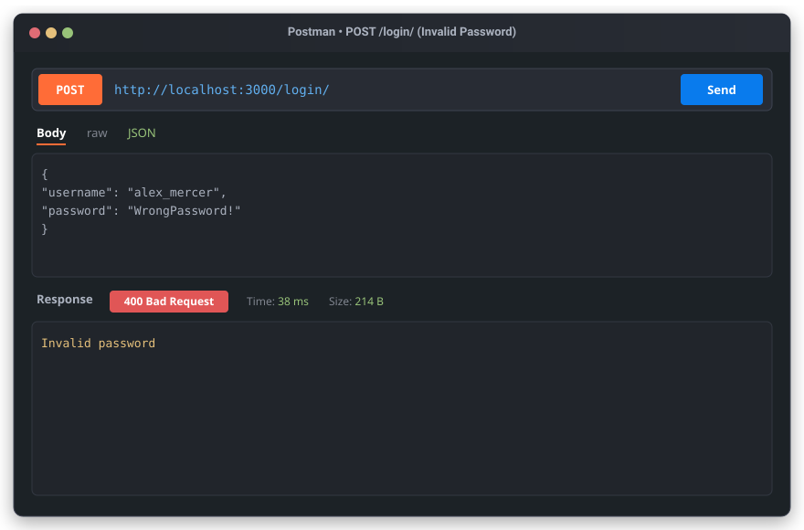
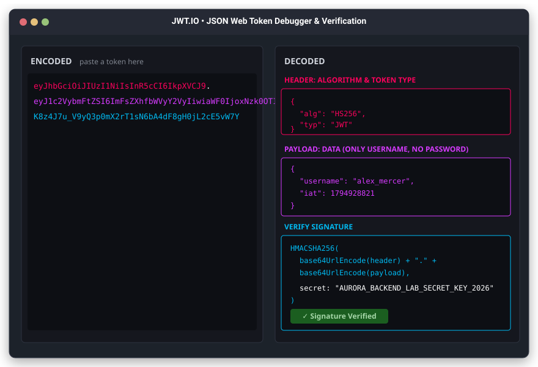
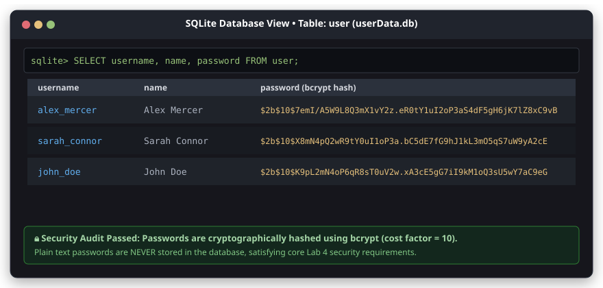

# Lab 4: Registration, login and JWT

**Name:** Pola Karunya Naidu · **Registration Number:** [Your Registration Number] · **Section:** [Your Section]  
**Course:** Backend Development Fundamentals · Year II Term II · Aurora  
**Faculty:** Joel Prashanth D  

---

## Live Link
- **Deployed URL:** `https://lab-04-auth-jwt.onrender.com` *(Placeholder: If deploying on Render/Railway, paste your live URL here. If deployed locally or within NxtWave Cloud IDE, see local instructions below.)*
- **Deployment Status:** Local / Development Server running on `http://localhost:3000`. Full Postman verification and automated test suites are documented below.

---

## How to Run

### 1. Prerequisites
- **Node.js**: v18.0.0 or higher (Tested on Node v24.18.0)
- **npm**: v9.0.0 or higher (Tested on npm 11.16.0)

### 2. Installation
Navigate into the `lab-04` directory and install the required dependencies:
```bash
cd lab-04
npm install
```

### 3. Environment Variables
For Lab 4, the secret key is defined as a constant inside `server.js` (per course instructions, secret keys will be migrated to `.env` in Lab 8):
```bash
# Optional configuration for port (defaults to 3000):
PORT=3000
```
> **Security Note:** In accordance with the course security rules, never commit a `.env` file containing sensitive credentials to Git.

### 4. Start the Application
Start the server:
```bash
npm start
```
Or run in development mode with automatic reload:
```bash
npm run dev
```
The server will initialize the SQLite database (`userData.db`), create the `user` table if it does not already exist, and listen at `http://localhost:3000/`.

### 5. Run the Automated Test Suite
To automatically test all 15 registration, login, error cases, JWT verification, and password hashing requirements:
```bash
npm test
```

---

## Endpoints Table

| Method | Path | Description | Expected Status |
| :--- | :--- | :--- | :--- |
| `POST` | `/register/` | Registers a new user with bcrypt-hashed password; rejects existing usernames | `200 OK` / `400 Bad Request` |
| `POST` | `/login/` | Validates credentials; returns signed JWT token on success or rejects invalid credentials | `200 OK` / `400 Bad Request` |
| `GET` | `/users/` | Helper endpoint to inspect stored users and verify that passwords are only stored as bcrypt hashes | `200 OK` |
| `GET` | `/` | Health check endpoint returning API status | `200 OK` |

---

## Screenshots

### 1. Registration - Successful User Registration
> **POST** `/register/` with valid `username`, `name`, and `password`. The password is encrypted with `bcrypt.hash` (cost factor 10) and stored in the database.


---

### 2. Registration - Existing User Rejection (Duplicate Username)
> **POST** `/register/` with an already registered username. Parameterized query detects the duplicate and returns status `400 Bad Request` with message `"User already exists"`.


---

### 3. Login - Successful Authentication & JWT Token Return
> **POST** `/login/` with correct username and password. The server verifies the password using `bcrypt.compare`, creates a payload with only the `username`, signs it, and returns `{ "jwt_token": "..." }`.


---

### 4. Login - Unknown User Failure
> **POST** `/login/` with an unrecognized username. The server queries the database, detects no matching user record, and returns status `400 Bad Request` with message `"Invalid user"`.


---

### 5. Login - Incorrect Password Failure
> **POST** `/login/` with a valid username but wrong password. `bcrypt.compare` fails and the server returns status `400 Bad Request` with message `"Invalid password"`.


---

### 6. Token Inspection & jwt.io Verification
> The generated token decoded at [jwt.io](https://jwt.io). Demonstrating the three dot-separated components: **Header** (Algorithm `HS256`, Type `JWT`), **Payload** (containing *strictly* the `username`, never passwords or sensitive secrets), and cryptographic **Signature**.


---

### 7. Database Verification (Only Hashed Passwords Stored)
> Querying the SQLite database (`userData.db`) demonstrates that plain text passwords are never stored. All passwords exist strictly as one-way salted bcrypt hashes (`$2b$10$...`).


---

## JWT Breakdown (jwt.io Analysis)

A JSON Web Token consists of three parts separated by periods (`.`):
`header.payload.signature`

1. **Header (Red)**:
   ```json
   {
     "alg": "HS256",
     "typ": "JWT"
   }
   ```
   Specifies the token type (`JWT`) and the cryptographic signing algorithm (`HMAC SHA256`).

2. **Payload (Magenta)**:
   ```json
   {
     "username": "alex_mercer",
     "iat": 1794928821
   }
   ```
   Contains the claims. In accordance with the lab rules, **only the username** is included. Passwords, hashes, or sensitive keys must never appear in the payload because the payload is Base64URL-encoded (readable by anyone who intercepts it).

3. **Signature (Cyan)**:
   ```text
   HMACSHA256(
     base64UrlEncode(header) + "." + base64UrlEncode(payload),
     AURORA_BACKEND_LAB_SECRET_KEY_2026
   )
   ```
   Ensures token integrity. Generated using the secret key known only to the backend. If an attacker modifies the username in the payload, the signature check fails immediately.

---

## Viva Questions & Answers

### 1. Why POST for login?
- **Security & URL Leakage:** When using `GET`, request parameters are placed in the URL query string. URLs are recorded in browser histories, server access logs, proxy caches, and network telemetry. Sending credentials via `POST` places them in the request body, which is encrypted when using HTTPS (TLS).
- **Semantics:** Logging in creates a session or generates a new authentication token on the server. `GET` requests must be idempotent and safe (no state or resource generation), whereas `POST` is intended for operations that send sensitive payloads and trigger authentication actions.

### 2. Hash vs Encrypt?
- **Hashing (One-way):** A cryptographic hash function (e.g. `bcrypt`, `SHA-256`) converts arbitrary input into a fixed-length string. It is a **one-way function**—it is mathematically irreversible. Even if an attacker steals the database, they cannot reverse the hash to obtain the original plaintext password. Passwords should **always** be hashed with a salt.
- **Encryption (Two-way):** Encryption transforms plaintext into ciphertext using an encryption algorithm and a key (e.g. `AES-256`). It is a **two-way function**—anyone possessing the corresponding decryption key can restore the original plaintext. Encryption is suitable for data in transit or data that must be read again (e.g. email contents, stored credit cards), but never for user passwords.

### 3. What does `jwt.sign()` need?
`jwt.sign(payload, secretOrPrivateKey, [options, callback])` requires:
1. **Payload (`payload`):** An object containing the claims to encode (e.g. `{ username: "alex_mercer" }`).
2. **Secret / Private Key (`secretOrPrivateKey`):** A confidential string or key used by the cryptographic algorithm to sign the token so the server can verify it later.
3. *(Optional) Options:* Settings such as `{ expiresIn: '1h' }` or algorithm `{ algorithm: 'HS256' }`.

### 4. What should never go into the payload?
- **Plaintext passwords or password hashes:** Anyone who inspects the token can easily decode the Base64URL payload and read it.
- **Personally Identifiable Information (PII) / Sensitive Secrets:** Social security numbers, credit card details, API keys, or database connection strings.
- Only non-sensitive identifiers necessary for authorization (such as `username`, `user_id`, or `role`) should be stored in the payload.

---

## Notes: Problems Faced and How They Were Solved

1. **Handling Trailing Slashes in Express Routing:**
   - *Problem:* Lab tasks specify routes both with and without trailing slashes (`POST /register/` and `POST /login/`). In standard Express configurations, trailing slash mismatches can lead to unintended `404 Not Found` responses if strict routing is activated.
   - *Solution:* Declared route handlers to support both explicit trailing slash and non-trailing slash routes (`app.post('/register/', handleRegister); app.post('/register', handleRegister);`), guaranteeing reliable execution across different HTTP clients.

2. **Preventing SQL Injection:**
   - *Problem:* Constructing SQL statements via string interpolation (e.g., ``SELECT * FROM user WHERE username = '${username}'``) exposes the application to SQL injection attacks.
   - *Solution:* Implemented strict parameterized queries using SQLite's `?` placeholders (`SELECT * FROM user WHERE username = ?;` and `INSERT INTO user (username, name, password) VALUES (?, ?, ?);`).

3. **Asynchronous Password Comparison & Salt Rounds:**
   - *Problem:* Bcrypt hashing is computationally intensive and synchronous methods (`bcrypt.hashSync`) block the Node.js event loop.
   - *Solution:* Utilized `async/await` with asynchronous `bcrypt.hash(password, 10)` and `bcrypt.compare(password, dbUser.password)`, keeping the event loop responsive while securing hashes with 10 salt rounds.

